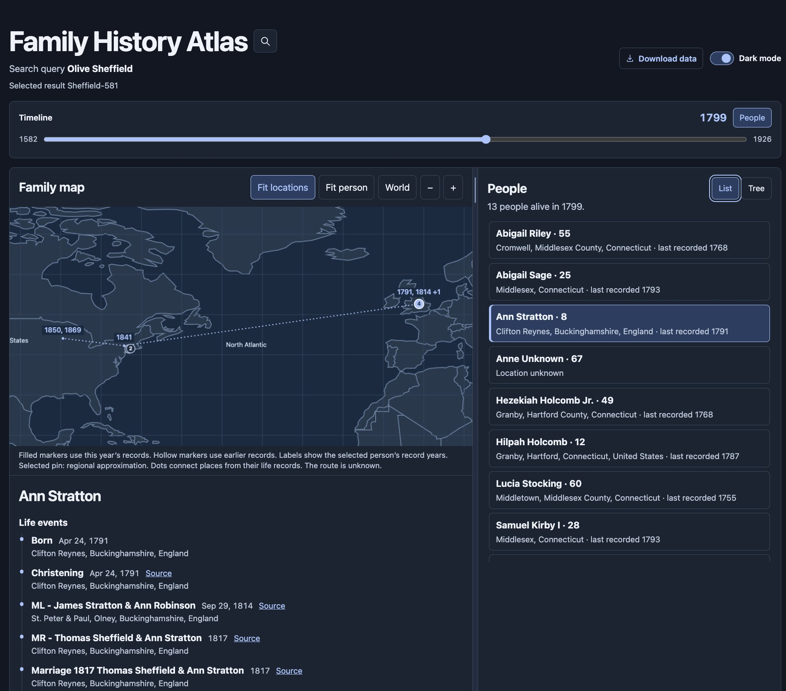

# Genealogy CLI



Research the ancestry of any public, deceased WikiTree profile. Enter a name, choose a match, and explore the person's tree in a local timeline.

## Run it

From this repository, run the script with Python 3.10+ and internet access. The script uses the standard library.

```sh
python3 genealogy.py
python3 genealogy.py --name "Samuel Clemens" --depth 3 --download-originals
python3 genealogy.py --name "Samuel Clemens" --birth-place Missouri
python3 genealogy.py --seed Clemens-1 --depth 4 --storyboard
python3 genealogy.py --seed Clemens-1 --no-research-text
python3 -m unittest discover -v
```

In an interactive terminal, the first command asks for a name. Choose the numbered match using its dates, birthplace, and WikiTree ID, or press Enter to cancel. The search asks WikiTree for the first given name and surname. Use `"de la Cruz, Maria"` for a multiword surname. It keeps up to 200 eligible public, deceased profiles and lists the closest full name first, so "John Parker Kirby" puts John Parker Kirby ahead of other John Kirbys. A narrower birthplace helps with common names. A WikiTree ID such as `Kirby-1882` looks up that profile directly, in the atlas search or with `--seed`.

Name searches generate a storyboard and open it in your default browser automatically. Use `--no-open` to save it without launching the browser. The terminal shows which profiles it finds, what it is fetching, and when a request is being retried. The original name and optional birthplace are saved in the local research JSON and displayed in the atlas header. Review search text before sharing an export. Progress goes to stderr and the UTC-stamped export directory goes to stdout. You can also open the exported `storyboard.html` directly from Finder. Click the magnifying glass next to the title to search WikiTree and choose a new starting profile and load its tree in the same tab. The search runs through a server bound to this computer. Scrub by year and click a relative or map marker to inspect their records. Ages show the age each person turned that year. Scrubbing outside a person’s lifespan clears the selection. “Alive” means their recorded birth and death years span the selected year, including both endpoints. The family tree uses relationships already in the export. The People panel opens in List view. Use **People** beside the timeline to hide or restore the panel. Switch to Tree to drag, scroll, or zoom through the parent–child links. Hover or focus a zoomed-out card for a readable preview. Each visible parent–child branch has its own junction. A square marks a recorded marriage between the displayed parents. Recorded spouses also appear in the person’s details. Tree defaults to people alive in the selected year. Clear **Alive this year only** for the full tree. Drag the divider to resize the map and People panel. Drag it to the left edge to close the map, and pull the handle back to reopen it. People who were alive in the selected year have an accent edge. You can switch the atlas and map between light and dark. A hollow marker uses the last available place record, which can be years earlier.

To install the shorter `genealogy` command, use a virtual environment.

```sh
python3 -m venv .venv
source .venv/bin/activate
python -m pip install .
genealogy --name "Samuel Clemens"
```

## Nix

Nix can serve an exported storyboard on this computer. It does not search WikiTree or create a new export. Generate a storyboard with the commands above, then run this from the repository:

```sh
nix run .#atlas -- exports/<timestamp>/storyboard.html
```

`nix run` does the same thing, because the atlas server is the default app. Put `--port 8765` before the page path to choose the port. The server prints `http://127.0.0.1:<port>/` and listens only on this computer. Search and **Download data** in the atlas use that server. Opening `storyboard.html` as a file does not.

This needs Nix with the `nix-command` and `flakes` features enabled. The flake pins Nixpkgs 25.05 and uses its Python 3.12. The program itself uses only the Python standard library. `exports/` stays on your machine and is not part of the repository.

## Download the current atlas

In the live local atlas, select **Download data** in the header. That request loads any photo lists that have not been opened yet, saves thumbnails into `images/`, and puts them in the ZIP with `research.json`, the CSV tables, and the standalone `storyboard.html`. It also includes the photo download log. Extract the ZIP and open `storyboard.html` to browse the saved tree. Browser search, photo loading, and creating a new ZIP require the local server.

## Download ancestor photos

A normal tree build does not request photo lists. In the atlas, open **Photos and documents** on a person to load that profile’s images. **Download data** loads the remaining profiles and stores thumbnails. `--download-originals` follows the same ancestor crawl as the research export and saves each distinct available full-size image to the run's `images/` folder. Set `--depth` to the number of parent generations to visit (0–8, default 5). Each public, deceased profile visited for a photo download is checked for a primary image and every page of attached images, including historical documents. `--download-photos` follows the same tree and downloads smaller thumbnails.

`photo_downloads.json` records the source page, requested image URL, local filename, and status for each photo entry. Unavailable URLs, unsupported formats, and originals over 32 MiB appear as unavailable. The download and storyboard stay local.

The timeline includes profile births and deaths, recorded marriages, and dated attachments with places. The offline basemap uses the Natural Earth 1:110m country boundaries (v5.1.2). Map pins use the 2025 U.S. Census Gazetteer or Natural Earth populated places (v5.1.2) for city and town matches. The Census county-subdivision data also locates explicitly named U.S. townships when the county matches. The legend labels broader approximations. Unmatched places remain in the records as text. Matching uses modern place names, so historical spellings and ambiguous names can fall back to a broader area. Drag the map to pan. Scroll over it or use its zoom buttons to zoom. **Fit person** frames the selected person’s mapped life records. Map labels show that person’s record years where space allows. The selected person’s dotted line connects mapped places from their life records. It shows the order of recorded places. The atlas shows biographies below the map. When the tree outgrows its panel, the biography moves below both panels at full width. Biographies include credit to WikiTree contributors, a link to the original profile, and the retrieval date. Exports keep the raw biography and citation text, which is what puts inline citation links in the atlas. Pass `--no-research-text` to leave biographies, citation bodies, and photo captions out of the files. Expand **Photos and documents** to load that person’s images. Saved copies are shown when they are already on this computer; otherwise the atlas requests them from WikiTree at that moment. [Natural Earth terms of use](https://www.naturalearthdata.com/about/terms-of-use/)

## API verification

The official anonymous API returns one-object JSON arrays. `getPerson` provides profile fields and numeric parent lookup IDs. Requesting `Bio` with `bioFormat=wiki` returns the biography as `bio`. `getPhotos` lists attachments independently of the primary photo. [Official API documentation](https://github.com/wikitree/wikitree-api)

Reproduce the preflight with the same anonymous endpoints. These commands print raw API responses locally.

```sh
for seed in Clemens-10 Clemens-1; do
  curl --fail --silent --show-error --get https://api.wikitree.com/api.php \
    --data-urlencode action=getPerson --data-urlencode "key=$seed" \
    --data-urlencode appId=genealogy-cli --data-urlencode bioFormat=wiki \
    --data-urlencode fields=Id,Name,Privacy,IsLiving,DeathDate,Father,Mother,DataStatus,Bio,Photo,PhotoData
  curl --fail --silent --show-error --get https://api.wikitree.com/api.php \
    --data-urlencode action=getBio --data-urlencode "key=$seed" \
    --data-urlencode appId=genealogy-cli --data-urlencode bioFormat=wiki
  curl --fail --silent --show-error --get https://api.wikitree.com/api.php \
    --data-urlencode action=getPhotos --data-urlencode "key=$seed" \
    --data-urlencode appId=genealogy-cli --data-urlencode start=0 --data-urlencode limit=10
done
```

## Outputs and privacy

`research.json` contains profiles, parent assertions, citations, photo metadata, immigration leads, branch summaries, full ancestry paths, and coverage gaps. Each of those tables also has a CSV. Nested CSV values are JSON. Partial dates preserve WikiTree's zero month or day. Provenance includes the profile URL, endpoint, API action, parameters, and UTC retrieval timestamp. Parent rows preserve WikiTree's relationship and biological-status markers and flag each link for evidence review. Coverage gaps include unavailable or filtered profiles, missing parents, and depth limits.

The CLI exports only profiles explicitly marked public or open and deceased, with a recorded death year. It follows parent IDs and includes public, deceased children of the starting profiles. The default keeps free-text biographies, citation bodies, and photo captions locally as WikiTree markup and attachment metadata. `--no-research-text` omits them. Before sharing exports containing text or images, review them for living relatives' details and image reuse terms. Each run has a private directory on Unix, and `exports/` is ignored by Git. This repository holds the program and the offline map data. It does not hold WikiTree biography text, photos, or research exports. The MIT license covers this program. It does not license WikiTree profiles, photographs, or biography text. WikiTree’s terms allow a research copy for a specific inquiry. They do not allow copying a substantial part of the site, and biography wording may be copyrighted by its authors. Keep each storyboard and `research.json` on your own machine.

## Immigration leads

Branch summaries rank candidates by the earliest dated U.S. presence lead available in the collected data. Birth and death locations can suggest migration and give an upper bound for presence. Keyword-only leads require review. A presence date can come from a much later record than arrival. The `earliest_immigrant` field remains unset until records and links are independently verified.

### Rebuild the offline place index

```sh
curl -fL https://www2.census.gov/geo/docs/maps-data/data/gazetteer/2025_Gazetteer/2025_Gaz_place_national.zip -o /tmp/atlas-us-places.zip
curl -fL https://www2.census.gov/geo/docs/maps-data/data/gazetteer/2025_Gazetteer/2025_Gaz_cousubs_national.zip -o /tmp/atlas-us-subdivisions.zip
curl -fL https://www2.census.gov/geo/docs/maps-data/data/gazetteer/2025_Gazetteer/2025_Gaz_counties_national.zip -o /tmp/atlas-us-counties.zip
curl -fL https://raw.githubusercontent.com/nvkelso/natural-earth-vector/v5.1.2/geojson/ne_10m_populated_places.geojson -o /tmp/atlas-world-places.geojson
curl -fL https://raw.githubusercontent.com/nvkelso/natural-earth-vector/v5.1.2/geojson/ne_110m_admin_0_countries.geojson -o /tmp/atlas-countries.geojson
python3 scripts/build_place_index.py /tmp/atlas-us-places.zip /tmp/atlas-us-subdivisions.zip /tmp/atlas-us-counties.zip /tmp/atlas-world-places.geojson /tmp/atlas-countries.geojson storyboard/places.json.gz
```
